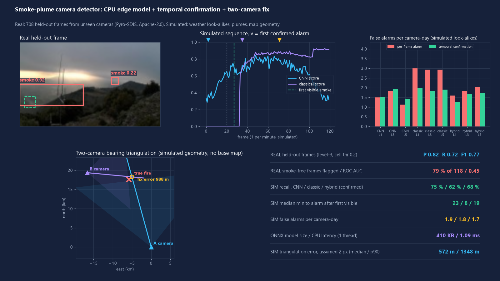
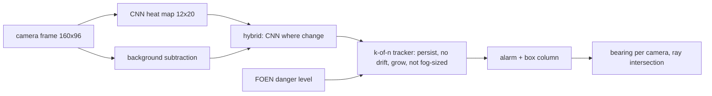

# smoke-plume-camera-detector

Open-source early wildfire smoke detection for fixed hilltop or tower cameras: a small CPU model (ONNX), temporal confirmation, an alarm threshold that follows the federal forest-fire danger level, and two-camera bearing triangulation.



**Read this first.** The single-frame model has **no useful skill on real held-out frames** (ROC AUC 0.45, see Results). At 160 x 96 pixels the labelled smoke is often 5 pixels wide. The plume, weather and geometry results below are **simulated**. This repo is a working pipeline and an honest baseline, not a validated fire-watch system.

## What it does

- **Detect**: 410 KB CNN (ONNX, 12 x 20 heat map) and a classical background-subtraction detector (colour, texture, change), plus a **hybrid** that keeps CNN detections only where the classical detector sees change.
- **Confirm**: a k-of-n frame tracker rejects flashes, sideways-drifting clouds, frame-filling fog and shrinking blobs before it alarms.
- **Adapt**: the alarm threshold and k-of-n depend on the FOEN/BAFU forest-fire danger level (live from the federal geo API; offline you pass the level).
- **Locate**: pixel column to compass bearing (pinhole), two-camera ray intersection to a latitude/longitude, with a Monte-Carlo error simulation.

Why: forest fires are a growing concern in the southern and dry-alpine cantons (Ticino, Valais, Graubuenden). The federal danger level is published daily at [waldbrandgefahr.ch](https://www.waldbrandgefahr.ch) (FOEN/BAFU) and the Swiss Federal Institute WSL researches forest-fire risk ([wsl.ch](https://www.wsl.ch), topic "Forest fire"). I did not independently quantify a regional trend; that premise comes from those institutions' general framing, not from this repo's data.

## Results

All numbers come from `python -m smokecam demo` (full run, saved in [`docs/results.json`](docs/results.json)).

### Real data: 708 held-out frames from 33 cameras never used in training

Source: Pyro-SDIS (Apache-2.0), 160 x 96 downscale. 590 frames with smoke, 118 without (the dataset's own false positives, so hard negatives). 83 % of the set is smoke, so precision looks flattering.

| Measure | Value |
|---|---|
| Per-frame precision / recall / F1 (level-3 cell threshold 0.20) | 0.82 / 0.72 / 0.77 |
| Smoke-free frames flagged (false-positive rate) | 79 % (93 of 118) |
| ROC AUC of the frame score | **0.45** (no better than chance) |
| Recall at 10 % false-positive rate | 10.5 % |
| Detection box overlaps the labelled smoke (flagged smoke frames) | 24 % |
| Real consecutive-frame sequences (>= 3 frames, < 15 min apart): smoke sequences confirmed | 52 of 75, median 3.5 frames |
| Real smoke-free sequences | none in the held-out set, so no real false-alarm rate |

The validation F1 of 0.69 on other training cameras did not carry over to hard held-out negatives. Likely causes: tiny targets at 160 x 96, 4.5 k training images, memorised camera backgrounds.

### Simulated sequences (procedural plumes and weather over real smoke-free frames)

40 plume sequences x 120 frames, 1 frame/minute assumed. A detection counts only if the alarm fires on the plume run and not on the identical smoke-free control. Time-to-alarm is measured from the first frame with >= 8 px of plume above 10 % opacity. False alarms: 30 smoke-free "camera-days" (14 h of daylight, 840 frames) with clouds, fog, glare, dust and exposure steps; episodes closer than 30 frames merge. Temporal confirmation on:

| Detector | Danger level | Plumes alarmed | Median min to alarm | False alarms / camera-day |
|---|---|---|---|---|
| CNN | 1-2 / 3 / 4-5 | 60 % / 75 % / 80 % | 31 / 23 / 24.5 | 1.5 / 1.9 / 1.4 |
| Classical | 1-2 / 3 / 4-5 | 72 % / 62 % / 62 % | 10 / 8 / 7 | 2.0 / 1.8 / 1.9 |
| Hybrid | 1-2 / 3 / 4-5 | 57 % / 68 % / 82 % | 24 / 19 / 19 | 1.3 / 1.7 / 1.7 |

- Temporal confirmation removes the classical detector's false alarms on clear-weather days entirely (2.8 to 0.0 per camera-day) but not those caused by simulated fog, glare and dust (about 2 per camera-day remain).
- Even after confirmation, about 1.3 to 2 false-alarm episodes per camera-day is too many for unattended use.
- Higher danger levels buy recall for the CNN-based detectors; false alarms stay roughly flat.

### Edge cost (CPU, 1 thread, onnxruntime)

| | Value |
|---|---|
| ONNX model size | 419,966 bytes (104,721 parameters) |
| CNN latency, 160 x 96 frame | 1.09 ms median, 1.77 ms p95 |
| Classical detector | 4.5 ms median |

### Two-camera triangulation (simulated geometry)

Cameras at illustrative summit positions near Monte Generoso and Monte Tamaro (25.5 km apart; no real installation). Fires 3 to 20 km from the midpoint, random smoke column in frame, heading calibration error 0.5 degrees (2000 trials per row, flat-earth local frame, no terrain model).

| Column error (160 px frame, 90 deg FOV) | Median error | p90 | No fix |
|---|---|---|---|
| 0.5 px | 141 m | 336 m | 2.2 % |
| 1 px | 285 m | 694 m | 2.4 % |
| 2 px (assumed) | 572 m | 1,348 m | 2.8 % |
| 4 px | 1,136 m | 2,588 m | 4.0 % |
| 10.7 px (measured detector error on real frames) | 2,702 m | 6,100 m | 8.5 % |

### Federal danger level (live feed)

`python -m smokecam danger` queries the FOEN/BAFU layer `ch.bafu.gefahren-waldbrand_warnung`. On the demo run: Sion-Sierre (VS) level 2 moderate, Rheintal (GR) level 4 high; the sample point at Lugano returned no region. Values change daily.

## Quick start

```bash
pip install -e ".[dev]"
python -m smokecam demo            # reproduces the numbers and figures (about 15 min on 4 CPU cores)
python -m smokecam demo --quick    # small CI run
python -m smokecam danger          # current federal danger level for three sample sites
python -m smokecam detect some_frame.jpg --level 4
python -m pytest
```

Retrain (needs torch and about 1.4 GB of network traffic; nothing large is stored):

```bash
pip install -e ".[data,train]" onnx
python scripts/prepare_data.py     # streams Pyro-SDIS, writes cache/ and data/testset/
python scripts/train.py            # about 17 min on CPU, writes models/smoke_cnn.onnx
```

## How it works



- CNN: six 3x3 conv blocks (dilated), stride 8, trained on cells overlapping labelled boxes. Camera-level train/test split by hash of the camera name.
- Classical: slow running background, global exposure gain removed, foreground that is grey/white and soft-edged, blobs at least 3 px wide.
- Policy per danger level: threshold and k-of-n of (0.60 / 0.30, 4 of 6), (0.50 / 0.20, 3 of 5), (0.40 / 0.12, 2 of 4) for classical / CNN scores.

## Data sources

- **Pyro-SDIS** wildfire smoke images, Pyronear association with French fire and rescue services, [huggingface.co/datasets/pyronear/pyro-sdis](https://huggingface.co/datasets/pyronear/pyro-sdis), **Apache-2.0** (permits training and redistribution with notice). `data/testset/` holds 708 downscaled frames with labels; see [NOTICE](NOTICE). The model was trained on 4,454 frames from other cameras.
- **Forest-fire danger level**: FOEN/BAFU warning layer via the federal geo API (listed on [opendata.swiss](https://opendata.swiss/en/dataset/waldbrandgefahrenwarnung)). Fetched live and read-only. Terms: opendata.swiss "Open use" (commercial use allowed, source citation not required; checked 2026-11-09 on the catalogue entry linked above). Only the one-line snapshot above is redistributed. Source: FOEN/BAFU.
- Synthetic plumes, clouds, fog, glare, dust: generated in `smokecam/synth.py`.

## What is not verified yet

- Real-world detection performance: the real-frame result is chance level. Needs full-resolution frames, more data and a proper detector (box regression, larger input).
- Simulated plumes are procedural blends and look nothing like real smoke texture; all sequence, time-to-alarm and false-alarm numbers are simulation-only and depend on my generator.
- No real smoke-free sequences were available, so real false-alarm rates are unknown.
- Time-to-alarm assumes 1 frame per minute; real cameras differ.
- Triangulation uses a flat-earth frame, no terrain (DEM), assumed heading error, and illustrative camera positions.
- Danger-level thresholds were set by hand and have not been tuned against fire outcomes.
- No field use, no customers, no affiliation with any camera or fire-watch provider.

## Licence

MIT, Copyright (c) 2026 VB-Builds. Test images carry the Apache-2.0 terms of their source (see NOTICE).
